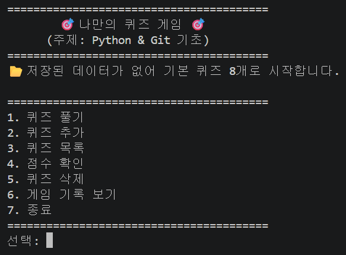
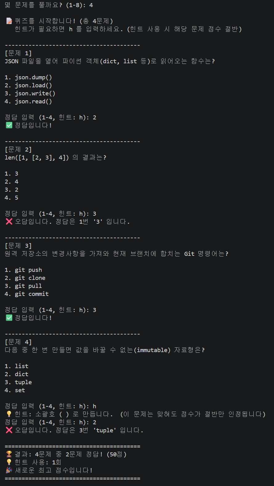
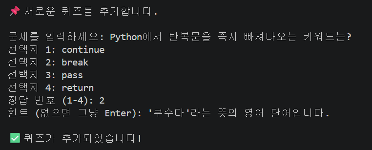
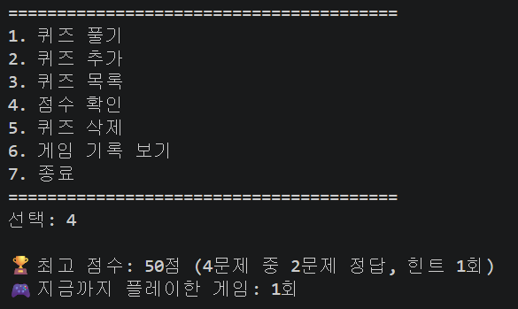
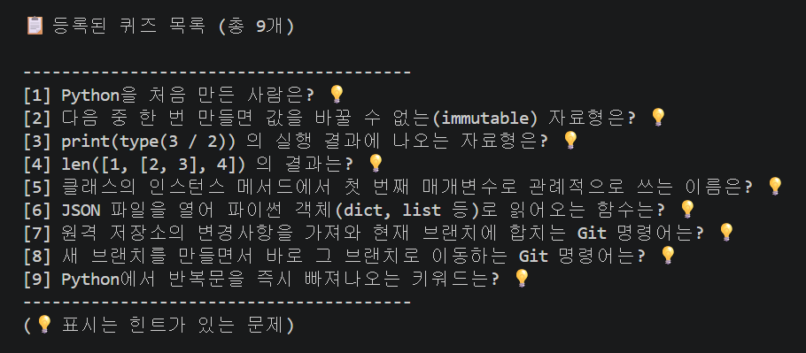
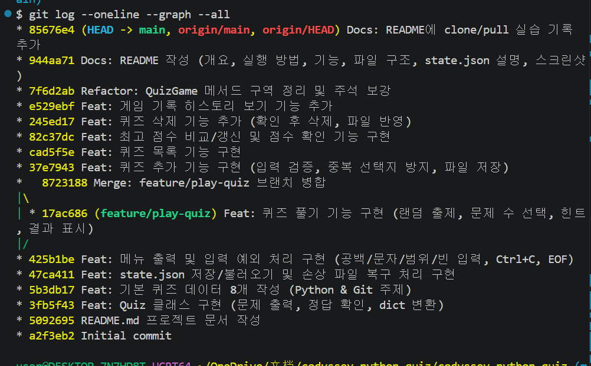
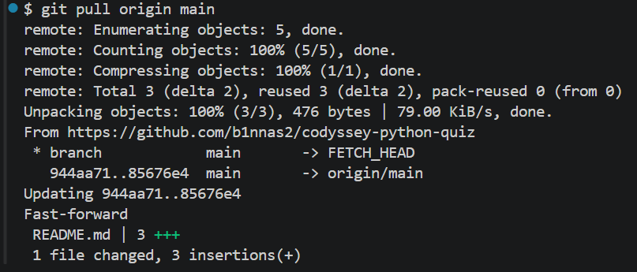
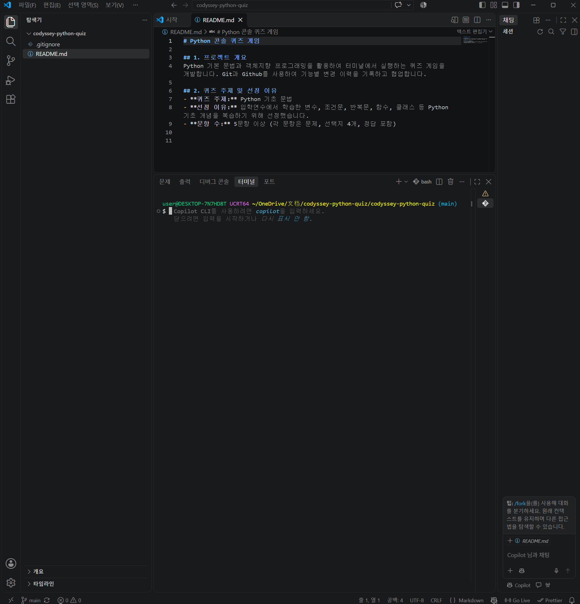
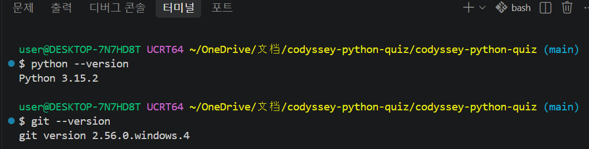
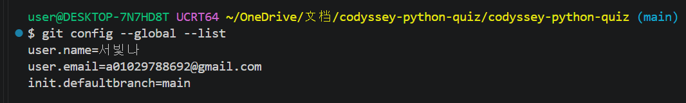

# 🎯 나만의 퀴즈 게임 (Python & Git 기초 퀴즈)

## 1. 프로젝트 개요

터미널에서 동작하는 4지선다 퀴즈 게임입니다.
메뉴에서 번호를 골라 퀴즈를 풀고, 새 퀴즈를 추가하고, 목록과 최고 점수를 확인할 수 있습니다.
퀴즈와 점수는 `state.json` 파일에 저장되기 때문에 프로그램을 껐다 켜도 그대로 남아 있습니다.

- 언어: Python 3.10 이상 (외부 라이브러리 없이 표준 라이브러리만 사용)
- 구조: `Quiz`(퀴즈 한 문제) / `QuizGame`(게임 전체 관리) 두 개의 클래스로 역할 분리
- 버전 관리: Git, GitHub (기능 단위 커밋, 브랜치 생성/병합) → 증빙은 [9. Git 작업 기록](#9-git-작업-기록)

## 2. 퀴즈 주제와 선정 이유

**주제: Python & Git 기초 상식**

이 미션에서 배우는 자료형, 클래스, JSON 파일 입출력, Git 명령어를 퀴즈로 만들면
게임을 만드는 동안 개념을 한 번 더 정리할 수 있고, 완성한 뒤에도 게임을 하면서 복습할 수 있습니다.
문제를 직접 만들면서 "정답이 왜 정답인지"를 설명할 수 있어야 해서 공부에도 도움이 되기 때문에 이 주제를 골랐습니다.

## 3. 실행 방법

```bash
# 1) 저장소 복제
git clone https://github.com/b1nnas2/codyssey-python-quiz.git
cd codyssey-python-quiz

# 2) Python 버전 확인 (3.10 이상)
python --version

# 3) 실행
python main.py
```

> macOS/Linux에서 `python`이 Python 2를 가리키면 `python3 main.py`로 실행합니다.

## 4. 기능 목록

| 메뉴 | 기능 | 설명 |
|---|---|---|
| 1 | 퀴즈 풀기 | 풀 문제 수를 고르면 문제를 **랜덤 순서**로 출제하고, 정답/오답과 최종 결과를 보여 줍니다. 풀이 중 `h`를 입력하면 **힌트**를 볼 수 있습니다(힌트를 쓴 문제는 맞혀도 점수 절반). |
| 2 | 퀴즈 추가 | 문제, 선택지 4개, 정답 번호(1-4), 힌트(선택)를 입력받아 등록하고 바로 파일에 저장합니다. |
| 3 | 퀴즈 목록 | 등록된 퀴즈를 번호와 함께 보여 줍니다. 힌트가 있는 문제는 💡로 표시합니다. |
| 4 | 점수 확인 | 최고 점수와 그때의 정답 수, 총 플레이 횟수를 보여 줍니다. |
| 5 | 퀴즈 삭제 | 번호를 골라 확인(y/n) 후 퀴즈를 삭제하고 파일에 반영합니다. (0 입력 시 취소) |
| 6 | 게임 기록 보기 | 날짜/시간, 푼 문제 수, 정답 수, 힌트 사용 수, 점수를 최근 10회까지 보여 줍니다. |
| 7 | 종료 | 데이터를 저장하고 종료합니다. |

### 점수 계산 방법
- 100점 만점, 문제당 `100 ÷ 푼 문제 수` 점
- 정답: 문제 점수 전부 / 힌트 사용 후 정답: 절반 / 오답: 0점
- 게임이 끝날 때마다 최고 점수와 비교해 더 높으면 갱신하고 저장합니다.

### 입력/예외 처리
- 모든 입력은 앞뒤 공백을 제거한 뒤 처리합니다. (예: ` 1 ` → `1`)
- 숫자가 아닌 입력(`abc`), 범위 밖 숫자(메뉴 `9`, 정답 `0`), 빈 입력(그냥 Enter)은 안내 메시지를 보여 주고 다시 입력받습니다.
- 퀴즈가 하나도 없을 때 풀기/목록/삭제를 고르면 안내 메시지를 보여 줍니다.
- 아직 퀴즈를 풀지 않았을 때 점수 확인/기록 보기를 고르면 안내 메시지를 보여 줍니다.
- `Ctrl+C`(KeyboardInterrupt)나 입력 스트림 종료(EOFError, `Ctrl+D`/`Ctrl+Z`)가 발생해도 오류 없이 저장 후 종료합니다.
- `state.json`이 없으면 기본 퀴즈로 시작하고, 손상되었으면 안내 메시지와 함께 `state.json.broken`으로 백업한 뒤 기본 퀴즈로 복구합니다.

## 5. 파일 구조

```
codyssey-python-quiz/
├── main.py              # 프로그램 시작점. Ctrl+C / EOF 처리 후 안전 종료
├── quiz_game.py         # QuizGame 클래스: 메뉴, 입력 처리, 게임 진행, 추가/목록/삭제, 점수, 저장/불러오기
├── quiz.py              # Quiz 클래스: 문제 출력, 정답 확인, dict 변환
├── default_quizzes.py   # 기본 퀴즈 8개 (Quiz 인스턴스로 생성)
├── state.json           # 퀴즈/점수 데이터 파일 (없으면 실행 시 자동 생성)
├── .gitignore
├── README.md
└── docs/
    └── screenshots/     # 실행 화면 캡처
```

## 6. 데이터 파일 설명 (`state.json`)

- **경로**: 프로젝트 루트(`main.py`와 같은 폴더)의 `state.json`
- **역할**: 퀴즈 목록, 최고 점수, 게임 기록을 저장해서 프로그램을 다시 실행해도 유지되게 합니다.
- **인코딩**: UTF-8 (`ensure_ascii=False`로 한글을 그대로 저장)
- **저장 시점**: 퀴즈 추가/삭제 직후, 게임 한 판이 끝난 직후, 종료할 때
- **안전한 저장**: `state.json.tmp`에 먼저 쓴 뒤 교체해서, 저장 도중 꺼져도 원본이 깨지지 않습니다.
- **파일이 없을 때**: 기본 퀴즈 8개로 시작하고 `state.json`을 새로 만듭니다.

### 스키마

| 키 | 타입 | 설명 |
|---|---|---|
| `quizzes` | list | 퀴즈 목록 |
| `quizzes[].question` | str | 문제 |
| `quizzes[].choices` | list[str] | 선택지 4개 |
| `quizzes[].answer` | int | 정답 번호 (1~4) |
| `quizzes[].hint` | str 또는 null | 힌트 (없으면 null) |
| `best_score` | int 또는 null | 최고 점수 (0~100), 아직 안 풀었으면 null |
| `best_record` | object 또는 null | 최고 점수 기록의 `total`(문제 수), `correct`(정답 수), `hints_used`(힌트 수) |
| `history` | list | 모든 게임 기록 |
| `history[].played_at` | str | 플레이 날짜/시간 (`YYYY-MM-DD HH:MM:SS`) |
| `history[].total` / `correct` / `hints_used` / `score` | int | 푼 문제 수 / 정답 수 / 힌트 사용 수 / 점수 |

### 예시

```json
{
    "quizzes": [
        {
            "question": "Python을 처음 만든 사람은?",
            "choices": ["귀도 반 로섬", "리누스 토르발스", "비야네 스트롭스트룹", "제임스 고슬링"],
            "answer": 1,
            "hint": "네덜란드 출신 프로그래머입니다."
        }
    ],
    "best_score": 80,
    "best_record": {"total": 5, "correct": 4, "hints_used": 0},
    "history": [
        {"played_at": "2026-11-09 17:30:00", "total": 5, "correct": 4, "hints_used": 0, "score": 80}
    ]
}
```

## 7. 실행 화면

| 메뉴 | 퀴즈 풀기 |
|---|---|
|  |  |

| 퀴즈 추가 | 점수 확인 |
|---|---|
|  |  |

| 퀴즈 목록 |
|---|
|  |

## 8. 설계 설명

### 8-1. 클래스를 사용한 이유 (객체지향 선택)

| 클래스 | 책임 | 가진 데이터(속성) | 주요 메서드 |
|---|---|---|---|
| `Quiz` (`quiz.py`) | 퀴즈 **한 문제**를 표현 | `question`, `choices`, `answer`, `hint` | `display()`, `is_correct()`, `to_dict()`, `from_dict()` |
| `QuizGame` (`quiz_game.py`) | 게임 **전체 흐름**을 관리 | `quizzes`, `best_score`, `best_record`, `history`, `state_path` | `run()`, `play_quiz()`, `add_quiz()`, `list_quizzes()`, `show_score()`, `save()`, `load()` |

함수만으로도 만들 수 있지만 클래스를 선택한 이유는 다음과 같습니다.

- **캡슐화**: 문제·선택지·정답은 항상 함께 다니는 데이터입니다. `Quiz` 객체 하나로 묶으면 `quiz.is_correct(3)`처럼 데이터와 그 데이터를 다루는 동작이 한곳에 모여, 정답 판정 규칙이 바뀌어도 `Quiz`만 고치면 됩니다.
- **상태 관리**: 퀴즈 목록, 최고 점수, 기록은 프로그램이 도는 동안 계속 바뀌는 상태입니다. 함수형으로 만들면 이 값들을 전역 변수로 두거나 모든 함수에 매개변수로 넘겨야 합니다. `QuizGame`의 속성(`self.quizzes`, `self.best_score`)으로 두면 메서드끼리 자연스럽게 공유됩니다.
- **역할 분리**: "문제 하나"와 "게임 전체"의 관심사가 나뉘어, `Quiz`는 저장 방식이나 메뉴를 몰라도 되고 `QuizGame`은 문제 출력 형식을 몰라도 됩니다.
- **확장성**: 힌트 기능을 추가할 때 `Quiz`에 `hint` 속성과 `has_hint()`만 더하면 됐습니다.

### 8-2. 기능별 코드 위치 (입력 처리 / 게임 진행 / 데이터 IO 경계)

| 역할 | 파일 | 메서드 |
|---|---|---|
| 프로그램 시작, Ctrl+C·EOF 처리 | `main.py` | `main()` |
| 메뉴 표시와 분기 | `quiz_game.py` | `run()`, `show_menu()`, `exit_game()` (메뉴 ↔ 메서드 매핑은 `MENU_ITEMS`) |
| **입력 검증** (공백 제거, 문자/범위/빈 입력) | `quiz_game.py` | `input_text()`, `input_number()`, `input_yes_no()`, `input_answer()` |
| **게임 진행** | `quiz_game.py` | `play_quiz()`, `ask_question_count()`, `ask_one_question()`, `calculate_score()`, `show_result()` |
| 점수·기록 | `quiz_game.py` | `record_game()`, `show_score()`, `show_history()` |
| 퀴즈 관리 | `quiz_game.py` | `add_quiz()`, `list_quizzes()`, `delete_quiz()` |
| **데이터 IO** | `quiz_game.py` | `load()`, `apply_state()`, `to_state()`, `save()`, `reset_to_default()`, `backup_broken_file()` |
| 문제 출력·정답 판정·변환 | `quiz.py` | `display()`, `is_correct()`, `to_dict()`, `from_dict()` |
| 기본 퀴즈 데이터 | `default_quizzes.py` | `create_default_quizzes()` |

입력 처리 메서드는 **값을 검증해서 돌려주기만** 하고 파일을 건드리지 않습니다. 파일을 읽고 쓰는 일은 데이터 IO 메서드만 합니다.

### 8-3. 요구사항이 바뀔 때 수정할 곳 (변경 지침)

| 바뀌는 요구사항 | 수정할 파일 | 수정할 메서드/위치 |
|---|---|---|
| 메뉴 추가·순서 변경 | `quiz_game.py` | `MENU_ITEMS`에 `("메뉴 이름", "메서드 이름")` 추가 후 그 메서드 작성 |
| 선택지 개수 변경 (예: 5지선다) | `quiz.py`, `default_quizzes.py` | `Quiz.CHOICE_COUNT`, 기본 퀴즈 선택지 |
| 퀴즈에 새 항목 추가 (예: 난이도) | `quiz.py`, `quiz_game.py` | `Quiz.__init__`, `to_dict()`, `from_dict()` / 필요하면 `add_quiz()` |
| 점수 계산 방식 변경 | `quiz_game.py` | `play_quiz()`의 `earned` 계산, `calculate_score()` |
| 기본 퀴즈 주제 변경 | `default_quizzes.py` | `create_default_quizzes()` |
| 저장 파일 위치·이름 변경 | `main.py` | `STATE_PATH` |
| 저장 형식 변경 (예: DB) | `quiz_game.py` | `load()`, `save()`, `apply_state()`, `to_state()` (다른 메서드는 그대로) |
| 입력 안내 문구 변경 | `quiz_game.py` | `input_*()` 메서드 |

### 8-4. 데이터 읽기/쓰기 흐름

- **읽기 순서** (`load()`)
  1. `state.json`이 없으면 → 기본 퀴즈로 시작하고 새 파일 생성
  2. 있으면 UTF-8로 읽고 `json.load()` → `apply_state()`에서 키·타입·값 범위 검사
  3. JSON 문법 오류나 형식 오류 → 안내 메시지, `state.json.broken`으로 백업, 기본 퀴즈로 복구 후 저장
  4. 권한 문제 등으로 읽기 자체가 실패 → 안내 메시지, 기본 퀴즈로 실행 (원본 파일은 건드리지 않음)
- **쓰기 대상**: 항상 프로젝트 루트(`main.py` 옆)의 `state.json`. 실행 위치와 상관없이 `Path(__file__)` 기준으로 정합니다.
- **쓰기 방법** (`save()`): `state.json.tmp`에 먼저 쓴 뒤 `os.replace()`로 교체해서, 저장 도중 꺼져도 기존 파일이 깨지지 않습니다.
- **저장 실패 시**: 경고 메시지를 출력하고 프로그램은 계속 실행됩니다(데이터는 메모리에 남음). 자동 재시도는 하지 않으며, 다음 저장 시점(퀴즈 추가/삭제, 게임 종료, 프로그램 종료)에 다시 시도합니다. 로그 파일은 따로 남기지 않고 화면 메시지로만 알립니다.
- **손상 백업 정책**: 백업은 `state.json.broken` **1개만** 유지하며, 다시 손상되면 최신 손상 파일로 덮어씁니다. (`.gitignore`로 저장소에는 올리지 않음)
- **비정상 종료 시 정책**: Ctrl+C·EOF로 종료하면 그 시점까지 저장된 퀴즈·최고 점수는 유지되고, **풀던 중인 퀴즈 결과는 저장하지 않습니다.** (끝까지 푼 게임만 기록)

### 8-5. JSON을 선택한 이유와 한계

**선택한 이유**
- **가독성**: 사람이 메모장으로 열어도 구조를 바로 알 수 있어 디버깅이 쉽습니다.
- **Python과 잘 맞음**: `dict`/`list`가 JSON 객체/배열과 그대로 대응되고, 표준 라이브러리 `json`만으로 읽고 쓸 수 있습니다. (외부 라이브러리 금지 조건 충족)
- **범용성**: 다른 언어나 웹에서도 그대로 읽을 수 있는 표준 형식입니다.

| 비교 | 텍스트(txt) | JSON | CSV | DB(SQLite 등) |
|---|---|---|---|---|
| 중첩 구조(선택지 리스트 등) | 직접 파싱 필요 | ✅ 그대로 표현 | 어려움 | 테이블 설계 필요 |
| 사람이 읽기 | 쉬움 | 쉬움 | 쉬움 | 도구 필요 |
| 대용량·검색 | 약함 | 약함 | 약함 | ✅ 강함 |

**한계와 대안**
- 저장할 때마다 **파일 전체를 다시 쓰고**, 불러올 때 **전체를 메모리에 올립니다.** 퀴즈와 기록이 수만 건 이상으로 커지면 저장이 느려지고 메모리 부담이 커집니다.
- 특정 퀴즈만 검색·수정하는 기능이 없어 항상 전체를 다룹니다.
- 여러 프로그램이 동시에 쓰면 나중에 쓴 쪽이 덮어써서 충돌이 납니다.
- 데이터가 많아지거나 여러 사용자가 쓰게 되면 표준 라이브러리 `sqlite3`(DB)로 전환하는 것이 적합합니다. 이때는 8-3 표대로 `load()`/`save()`/`apply_state()`/`to_state()`만 바꾸면 됩니다.

## 9. Git 작업 기록

### 9-1. 커밋 메시지 규칙

형식: `타입: 변경 내용 요약 (세부 내용)`

| 타입 | 의미 | 예시 |
|---|---|---|
| `Feat` | 새 기능 | `Feat: 퀴즈 추가 기능 구현 (입력 검증, 중복 선택지 방지, 파일 저장)` |
| `Fix` | 버그 수정 | `Fix: 점수 계산 오류 수정` |
| `Refactor` | 동작은 같고 구조만 개선 | `Refactor: QuizGame 메서드 구역 정리 및 주석 보강` |
| `Docs` | 문서 수정 | `Docs: README 작성 (개요, 실행 방법, ...)` |
| `Chore` | 설정 등 기타 | `Chore: 프로젝트 초기 설정` |
| `Merge` | 브랜치 병합 | `Merge: feature/play-quiz 브랜치 병합` |

- **커밋 단위**: 기능 하나가 완성되어 실행 확인까지 끝나면 커밋합니다. (메뉴 → Quiz → 기본 데이터 → 저장 → 풀기 → 추가 → 목록 → 점수 → 삭제 → 기록 → 정리 → 문서 순)
- **작성 규칙**: 제목은 한 줄로 무엇을 했는지 쓰고, 괄호에 세부 내용을 적습니다. "수정", "update"처럼 내용을 알 수 없는 메시지는 쓰지 않습니다.

### 9-2. 브랜치 전략과 병합 규칙

- `main`: 항상 **실행 가능한 상태**를 유지하는 기본 브랜치입니다.
- `feature/기능이름`: 규모가 큰 기능은 main에서 갈라져 나와 따로 작업합니다. 작업 중 코드가 깨져도 main에는 영향이 없습니다.
- 이 프로젝트에서는 가장 핵심이고 코드가 많은 **퀴즈 풀기 기능**을 `feature/play-quiz` 브랜치에서 개발했습니다.
- **병합 규칙**: 기능이 완성되고 실행 테스트를 통과하면 main으로 병합합니다. `git merge --no-ff`를 사용해 병합 커밋을 남겨, 어떤 커밋들이 하나의 기능으로 묶여 들어왔는지 이력에서 보이게 합니다.
- 팀 협업으로 확장하면 이 병합 단계를 GitHub Pull Request와 코드 리뷰로 대체할 수 있습니다.

```bash
git checkout -b feature/play-quiz      # 브랜치 생성 후 이동
git add quiz_game.py
git commit -m "Feat: 퀴즈 풀기 기능 구현 (...)"
git checkout main                      # main으로 이동
git merge --no-ff feature/play-quiz -m "Merge: feature/play-quiz 브랜치 병합"
git push origin main
git push origin feature/play-quiz      # 원격에도 브랜치 기록 보관
```

### 9-3. 원격 저장소와 커밋 이력

- 원격 저장소: https://github.com/b1nnas2/codyssey-python-quiz
- 커밋 수: 17개 (이 README 보완 커밋 이전 기준)

`git log --oneline --graph --all` 결과:

```
* c5dc9b5 Docs: 제출용 스크린샷 추가 (개발 환경, pull, git log)
* 85676e4 Docs: README에 clone/pull 실습 기록 추가
* 944aa71 Docs: README 작성 (개요, 실행 방법, 기능, 파일 구조, state.json 설명, 스크린샷)
* 7f6d2ab Refactor: QuizGame 메서드 구역 정리 및 주석 보강
* e529ebf Feat: 게임 기록 히스토리 보기 기능 추가
* 245ed17 Feat: 퀴즈 삭제 기능 추가 (확인 후 삭제, 파일 반영)
* 82c37dc Feat: 최고 점수 비교/갱신 및 점수 확인 기능 구현
* cad5f5e Feat: 퀴즈 목록 기능 구현
* 37e7943 Feat: 퀴즈 추가 기능 구현 (입력 검증, 중복 선택지 방지, 파일 저장)
*   8723188 Merge: feature/play-quiz 브랜치 병합
|\
| * 17ac686 Feat: 퀴즈 풀기 기능 구현 (랜덤 출제, 문제 수 선택, 힌트, 결과 표시)
|/
* 425b1be Feat: 메뉴 출력 및 입력 예외 처리 구현 (공백/문자/범위/빈 입력, Ctrl+C, EOF)
* 47ca411 Feat: state.json 저장/불러오기 및 손상 파일 복구 처리 구현
* 5b3db17 Feat: 기본 퀴즈 데이터 8개 작성 (Python & Git 주제)
* 3fb5f43 Feat: Quiz 클래스 구현 (문제 출력, 정답 확인, dict 변환)
* 5092695 README.md 프로젝트 문서 작성
* a2f3eb2 Initial commit
```

- 브랜치 생성: `17ac686` (feature/play-quiz 브랜치에서 작업)
- 브랜치 병합: `8723188` (main으로 `--no-ff` 병합, 위 그래프의 갈라졌다 합쳐지는 선)

`git branch -a` 결과:

```
  feature/play-quiz
* main
  remotes/origin/HEAD -> origin/main
  remotes/origin/feature/play-quiz
  remotes/origin/main
```



### 9-4. clone / pull 실습 기록

1. 원격 저장소를 별도 폴더(`quiz-clone`)에 복제했습니다.
2. 복제한 폴더에서 README에 실습 기록을 추가하고 commit → push 했습니다. (커밋 `85676e4`)
3. 원래 작업 폴더에서 pull로 변경사항을 받아 README에 반영된 것을 확인했습니다.

```bash
cd ..
git clone https://github.com/b1nnas2/codyssey-python-quiz.git quiz-clone
cd quiz-clone
# README.md에 실습 기록 추가
git add README.md
git commit -m "Docs: README에 clone/pull 실습 기록 추가"
git push origin main

cd ../codyssey-python-quiz
git pull origin main
```

원래 작업 폴더에서 실행한 `git pull origin main` 결과:

```
remote: Enumerating objects: 5, done.
remote: Counting objects: 100% (5/5), done.
remote: Compressing objects: 100% (1/1), done.
remote: Total 3 (delta 2), reused 3 (delta 2), pack-reused 0 (from 0)
Unpacking objects: 100% (3/3), 476 bytes | 79.00 KiB/s, done.
From https://github.com/b1nnas2/codyssey-python-quiz
 * branch            main       -> FETCH_HEAD
   944aa71..85676e4  main       -> origin/main
Updating 944aa71..85676e4
Fast-forward
 README.md | 3 +++
 1 file changed, 3 insertions(+)
```

`944aa71..85676e4`: 작업 폴더에 없던 clone 쪽 커밋(`85676e4`)을 받아와 Fast-forward로 반영했습니다.



### 9-5. 사용한 Git 명령어

| 명령어 | 하는 일 | 이 프로젝트에서 사용한 곳 |
|---|---|---|
| `git init` | 현재 폴더를 Git 저장소로 만듦 | 로컬 저장소 생성 |
| `git add` | 변경 파일을 커밋할 목록(스테이징)에 올림 | 매 기능 커밋 전 |
| `git commit` | 스테이징된 변경을 이력으로 저장 | 기능 단위 커밋 17회 |
| `git push` | 로컬 커밋을 GitHub에 올림 | 초기 설정, 병합 후, README 작성 후, clone 실습 |
| `git pull` | GitHub의 변경을 받아 현재 브랜치에 합침 | clone 실습 후 원래 폴더에서 |
| `git checkout` | 브랜치 이동/생성(`-b`) | `feature/play-quiz` 생성 및 main 복귀 |
| `git clone` | 원격 저장소를 통째로 복제 | `quiz-clone` 폴더로 복제 |
| `git merge` | 다른 브랜치의 작업을 합침 | `feature/play-quiz` → `main` |

## 10. 제출 스크린샷

| 개발 환경 | |
|---|---|
| VSCode |  |
| Python 버전 |  |
| Git 설정 |  |
